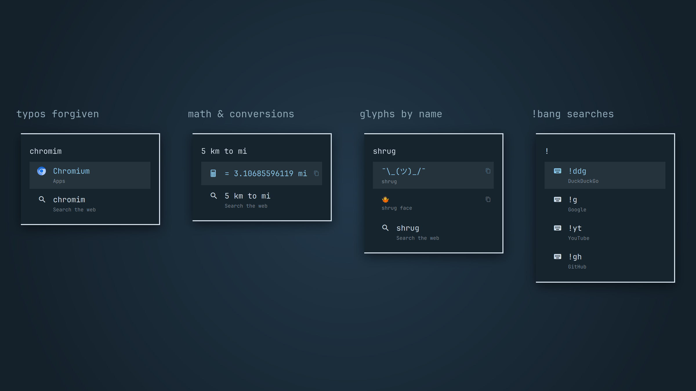
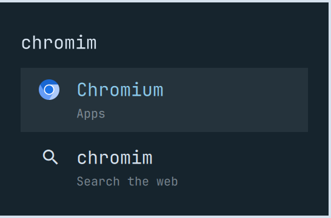
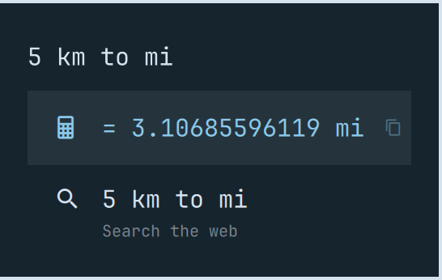
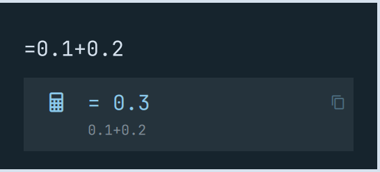
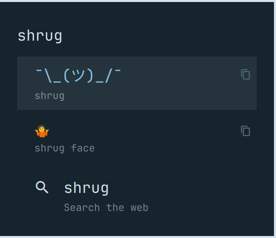
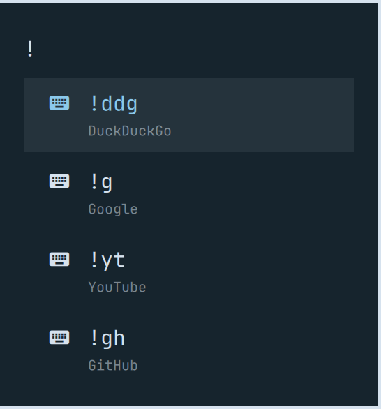

# Skål Menu

**Fully updated for Omarchy 4.5.**

This is Omarchy's own launcher menu ([`omarchy.menu`](https://github.com/omacom/omarchy)), rebased on the 4.5 release. On top of it are the features people keep asking for in the Omarchy tracker: a calculator, typo-tolerant search, apps ranked first, frecency, glyph search and `!bang` web searches.



## What it adds

**Apps come first** ([omacom/omarchy#10340](https://github.com/omacom/omarchy/issues/10340), [#7630](https://github.com/omacom/omarchy/issues/7630)).
- When an installed app's name starts with what you typed, the app ranks above menu actions with the same name. Typing `rust` and pressing Enter launches RustDesk, not Remove › Development › Rust.
- Rows under **Remove** sink below every other match, so a short query can't uninstall something by accident.

**Frecency** ([#10726](https://github.com/omacom/omarchy/issues/10726), [#11580](https://github.com/omacom/omarchy/issues/11580)).
- Apps and actions you open often, and recently, rank higher.
- Use is counted per launch and halves every week.
- The history lives in `~/.local/state/skal-menu/frecency.json` (the last 300 items). Delete that file to reset it.

**Typo and initials matching** ([#2074](https://github.com/omacom/omarchy/issues/2074)).
- `chromim`, `fils` and `spotfy` still find their app.
- Typo matches only reach apps and submenus, never actions. A near miss can open something, but it can't run anything.



**Calculator** ([#13980](https://github.com/omacom/omarchy/issues/13980)).
- Type math right in the search box and press Enter to copy the answer:
  - `2+2`, `(3+4)*2`, `2^10`, `2pi`, `sqrt(144)`, `0xff + 1`, `0b1010`
  - implicit multiplication: `2(3+4)`
- Functions: sqrt, cbrt, abs, round, floor, ceil, exp, ln, log, log2, log10, sin, cos, tan, asin, acos, atan.
- Constants: pi, e, tau.
- Conversions use `<value> <unit> to <unit>` (or `in`). They cover length, mass, temperature, speed, volume, time and data: `5 km to mi`, `72f to c`, `100 kg in lb`, `100mph to kmh`, `1 cup to ml`, `3 hours to min`, `1024 mb to gb`.
- Start with `=` (`=0.1+0.2`) to make it calculator-only: the answer, or nothing while you're still typing.

 

**Glyphs by name.** `shrug`, `em dash`, `arrow right`, `euro` and so on. Enter copies the glyph.



**`!bang` searches** ([#11580](https://github.com/omacom/omarchy/issues/11580)).
- `!yt lofi beats` searches YouTube in your default browser.
- Available bangs: `!ddg`, `!g`, `!yt`, `!gh`, `!w` (Wikipedia), `!aw` (Arch Wiki), `!aur`, `!pkg` (Arch packages) and `!maps`.
- Type `!` alone to list them; Enter on one fills it into the search box.
- Every other query also gets a "Search the web" row at the bottom ([#7012](https://github.com/omacom/omarchy/issues/7012)).

 

**Flatpak apps in search**, with icons, even when the session misses their export directories ([#1881](https://github.com/omacom/omarchy/issues/1881), [#8650](https://github.com/omacom/omarchy/issues/8650)).

Everything else is the stock 4.5 menu, unchanged: the Learn, Appearance, Trigger, Setup, Install, Remove and Update menus; `omarchy menu` routes; dmenu mode; translations; and your `~/.config/omarchy/extensions/omarchy-menu.jsonc` extensions.

## Install

```bash
omarchy plugin add https://github.com/outcrop-labs/skal-menu.git --enable --yes
```

It replaces the stock menu wherever the stock menu is used: SUPER+SPACE, `omarchy menu …` and the bar's menu button. Omarchy routes the built-in id to the enabled clone.

On Omarchy versions before 4.5, enabling a menu plugin didn't persist across shell restarts. If the stock menu comes back after a reboot on an older build, add `{ "id": "skal.menu" }` to the `plugins` array in `~/.config/omarchy/shell.json`.

## Removal

```bash
omarchy plugin remove skal.menu
```

The stock Omarchy menu takes over again.

## Credit

The menu itself is Omarchy's own `omarchy.menu` (MIT), cloned and extended. The calculator, conversions, ranking, typo matching, frecency, web and bang searches, glyph search and app-scanning additions are MIT, from Outcrop Labs.
